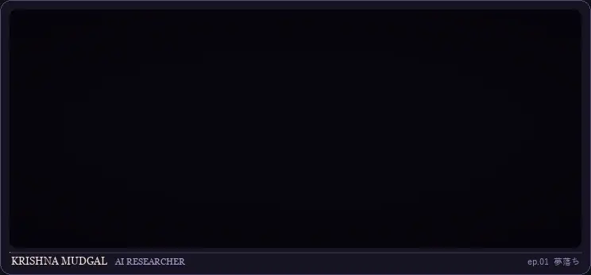

# Dreamfall · ep.01

A 39-second anime short made for my GitHub profile. I'm chased at dusk, fall off a cliff into an AI dreamworld
(loss landscapes, latent geometry, floating cubes), and wake up in my room, where the paper on the desk reads
**KRISHNA MUDGAL · AI RESEARCHER**.



Everything is built from my own storyboard frames. No new artwork is generated: the film is camera moves (pan, push,
roll, shake), a real two-frame run cycle, particles, and transitions chosen per beat (a light-sweep wipe through the
dimensional boundary, a block dissolve from dream to bedroom, a focus pull on the paper).

## Outputs

| File | What |
|---|---|
| `public/animation.webp` | README card (744×346, 12.5 fps, about 7 MB, animated WebP) |
| `public/poster.jpg` | still of the reveal |
| `public/pfp.png` | 800×800 profile picture |
| `index.html` | full-quality web version (canvas, 1440×600, film grain, optional sound) |
| `profile/` | my GitHub profile README and its assets |

> **Why WebP and not GIF?** Painted textures plus a moving camera are the worst case for GIF. A 446px GIF was still
> 18 MB, and full size was 90 MB. Animated WebP is 7 MB at full size and GitHub renders it in READMEs.

## How it works

```
assets/original/            the storyboard sheets, untouched
assets/extracted-frames/    every panel, auto-cropped (tools/extract_panels.py)
assets/processed/           the 21 keyframes used, renamed in story order
src/timeline.json           the film: shots, camera keys, transitions, particles  <- edit this
tools/render.py             timeline -> README card (WebP) + poster
src/player.js               the same timeline -> live canvas for the web version
```

Both renderers run the same timeline with the same camera maths, so the web version and the README card show the same
film. Every shot has a source frame (or two, for the run cycle), a camera move from `from` to `to`
(`x,y` = point of the image at frame centre, `z` = zoom, `r` = roll), easing, optional shake, particles
(`leaves | debris | sparks | motes`) and a transition in (`cut | dissolve | fadeblack | wipe | blocks | focus`).

## Run

```bash
pip install pillow numpy
python tools/extract_panels.py   # split sheets into panels
python tools/build_assets.py     # pick keyframes, export web frames, cut the pfp
python tools/render.py --only webp --quality 70

python -m http.server 8000       # web version at http://localhost:8000
                                 # http://localhost:8000/?t=24.5 renders a still at 24.5 s
```

`tools/contact.py` writes labelled contact sheets of all panels to `assets/previews/`, and every render writes
`assets/previews/timeline_contact.jpg` (one frame per second) for review.

## Deploy the web version (GitHub Pages)

Push this repo as `krishna-anime`, then go to **Settings → Pages → Deploy from branch → `main` / root**.
It goes live at `https://mudgalkrishna.github.io/krishna-anime/`. The page needs no build step and has no dependencies.

## Put it on the GitHub profile

1. Create a public repo named exactly **`mudgalKrishna`**. That is the special profile repo.
2. Copy `profile/README.md` and `profile/assets/` into it and push.
3. The card is the first thing in that README:

```html
<a href="https://mudgalkrishna.github.io/krishna-anime/">
  
</a>
```

The profile picture can't be set through the API. Upload `public/pfp.png` at **github.com/settings/profile**.
